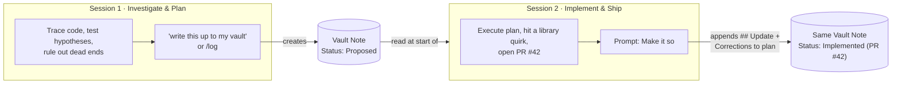

# pi-captains-log

*Captain's log, stardate today.* Living engineering notes across coding-agent sessions for [pi](https://pi.dev) and [oh-my-pi](https://github.com/can1357/oh-my-pi).

Every non-trivial engineering task spans multiple sessions. You spend an hour with your agent tracing a bug, comparing architectures, or running an evaluation. You rule out three dead ends, find the one code path that actually matters, and stop for the day. Tomorrow — or three weeks later — a fresh session starts at zero. If you didn't write it down, you re-read the same files and re-litigate the same dead ends.

Most "agent memory" tools write hidden state for the bot. `pi-captains-log` maintains **your** engineering notebook in your own Markdown vault (Obsidian or any folder of notes). You work interactively with the agent; when you hit a cognitive or git stopping point, the agent crystallizes the session into **one living topic note** that evolves from initial investigation → design plan → implementation → verification, so you or a fresh agent session can resume cold in seconds.

---

## Why it works differently

| Typical agent notes / memory | `pi-captains-log` |
|---|---|
| Appends a noisy daily diary of `git push` summaries | Maintains **one living note per topic or project** that evolves in place |
| Transcribes chat play-by-play or dumps raw command output | Distills the **4 load-bearing pillars** needed to resume cold |
| Overwrites earlier plans when reality changes | Appends `## Update YYYY-MM-DD` with explicit **Corrections to the plan above** so history is preserved |
| Saves only when code ships | Captures **pre-code plans, root-cause investigations, eval write-ups, and PR stack reviews** |
| Invents a new folder per git repo | Searches your vault first and files into your **existing nested domain/topic folders** |

---

## The multi-session loop



### 1. Capture at any stopping point (cognitive or git)
- **Natural language or `/log`:** Say *"let's write this up into a markdown file in my vault"*, *"save this plan so it doesn't get lost"*, or run `/log [optional focus]` at the end of a planning, debugging, evaluation, or review session — before a single line of code is committed.
- **Automatic git stopping points:** Opening a PR (`gh pr create`), merging one (`gh pr merge`), or cutting a release (`gh release create`) prompts once when the turn ends: **Make it so**, **Not now**, or **Stop asking this session**. Intermediate `git push`es are collected quietly and included when you finally log, and failed/no-op commands (`Everything up-to-date`, `--dry-run`, or a rejected push piped through `| tail`) never false-trigger.

### 2. Distill the four pillars that let you resume cold
Every session write-up answers four questions — adapting its headings to whether you are writing a **plan**, **investigation**, **evaluation report**, or **PR review**:
1. **What were we trying to accomplish, and under what constraints?**
2. **What did we change, decide, or discover — and why?** Exact `path/to/file.py::symbol` references, the mental model, and an explicit table of **Alternatives ruled out** with the concrete reason each failed so a future session never retries a dead end.
3. **What did we actually verify?** Benchmark/eval tables, exact queries or commands worth re-running, ticket IDs, PRs, and commit SHAs — kept strictly separate from `[INFERENCE]` or unverified assumptions.
4. **What is unfinished or next?** Open blockers and the **exact first step** for the next session.

### 3. Evolve the note in place as reality changes
Before creating a file, the agent searches your vault by ticket, PR, repo, and topic. When you pick the work back up in a later session, it updates `Status:` at the top and appends a dated `## Update YYYY-MM-DD` section at the bottom — recording what shipped and any **Corrections to the plan above** where implementation disproved an earlier assumption.

---

## Example: one living note across two sessions

```markdown
# WebSocket reconnect cursor replay in local-first sync

Status: Implemented (orbit/sync-engine#42)
Date: 2026-10-18
Scope: Client-resume frame replay when laptops wake from sleep
Repositories: orbit/sync-engine, orbit/desktop-client
Tickets/PRs: SYNC-118, https://github.com/orbit/sync-engine/pull/42
Related: [[2026-10-11 SQLite WAL checkpoint benchmarks]]

## What happened
Clients waking after >5 minutes of sleep dropped mutations that arrived while the socket was half-open:
the server keyed its replay ring buffer by wall-clock timestamp (`received_at_ms`), which drifted across
broker nodes. We designed and benchmarked a monotonic SQLite `rowid` cursor with a bounded catch-up batch.

## Findings / evidence
Replayed 50,000 synthetic reconnect storms across a 3-node local cluster (`bench/reconnect_sim.ts`):

| Cursor strategy | Missed frames | p95 catch-up time | Broker RSS delta |
|---|---|---|---|
| Wall-clock `received_at_ms` (current) | 142 | 310ms | +4 MB |
| Monotonic `seq_id` + SQLite WAL index | 0 | 38ms | +6 MB |
| Full snapshot resync on every wake | 0 | 1,840ms | +92 MB |

- `src/broker/replay.ts::streamSinceCursor` — reads frames where `seq_id > clientCursor` in 500-row pages.
- `[INFERENCE]` Mobile background-tab throttling >30 minutes was not tested against production load balancers.

## Decision / design
Issue a monotonic `seq_id` per room from the SQLite WAL log and fall back to a snapshot only when the client's
`seq_id` is older than the 24-hour retention window.

### Alternatives ruled out
| Option | Why rejected |
|---|---|
| Hybrid logical clocks (HLC) | Required changing the binary frame header on every existing desktop client. |
| In-memory ring buffer per room | Evicted active rooms under memory pressure and lost history on broker restart. |

## Open items
- Next: wire `streamSinceCursor` into `src/server/ws_handler.ts` and open PR for SYNC-118.

## Update 2026-10-20: implemented in orbit/sync-engine#42
Shipped cursor replay (`a4c91e0`) and opened https://github.com/orbit/sync-engine/pull/42.

Corrections to the plan above:
- `better-sqlite3` `.iterate()` holds a read lock across `await ws.send()` backpressure pauses and blocked
  concurrent writers; switched to materializing each 500-row page in memory before flushing to the socket.
- Next: merge #42 after CI passes and watch `sync_snapshot_fallback_total` in staging.
```
---

## Install

```bash
pi install npm:pi-captains-log   # pi
omp install pi-captains-log      # oh-my-pi
```

Try it from a local checkout without installing:

```bash
pi -e ./pi-captains-log
omp -e ./pi-captains-log
```

## Configure

| Variable | Default | Meaning |
|---|---|---|
| `PI_CAPTAINS_LOG_VAULT` | (required) | Absolute path to your notes vault; `~/` is expanded |
| `PI_CAPTAINS_LOG_<ROLE>_DIR` | see layout | Pin a role's folder (`INBOX`, `PROJECTS`, `RESEARCH`, `MEETINGS`, `CAREER`, `ARCHIVE`), e.g. `PI_CAPTAINS_LOG_PROJECTS_DIR="Work/Projects"` |
| `PI_CAPTAINS_LOG_GIT` | `commit` | `off`, `commit` (commit changed notes), or `push` (commit and push) |

## Vault layout

```text
your-vault/
├── 00 Inbox/        notes with no clear domain home yet
├── 10 Projects/     nested domain/project folders (e.g. Sync Engine/Plans/, Sync Engine/Investigations/)
├── 20 Research/     cross-cutting technical topics, workflows, benchmarks
├── 30 Meetings/     meeting notes and recaps
├── 40 Career/       accomplishments and brag-doc entries (written only on request)
└── 90 Archive/      finished projects (moved only on request)
```

Each role adopts any matching folder you already have at the top level (ignoring number prefixes and case — e.g. `Projects/` or `2 - Research/`). Numbered folders are only created when a role is missing, keeping Obsidian's sidebar in reading order. Inside `10 Projects/` and `20 Research/`, the agent inspects your existing nested subfolders and files notes alongside related work.

## Package layout

```text
pi-captains-log/
├── extensions/captains-log/index.ts   stopping-point detection, prompt, /log command
├── src/                               milestone rules, vault layout, prompt builder
├── skills/captains-log/
│   ├── SKILL.md                       living-note workflow, 4 pillars, multi-session updates, vault search
│   └── templates/                     research-note.md (session note), meeting-note.md
└── test/
```

The extension handles **when** to ask and passes the resolved vault layout, detected git milestones, and git policy. The `captains-log` skill governs **how** to search, structure, and update notes.

## Develop

Requires Node 22.18 or later (TypeScript runs natively, no build step).

```bash
npm install
npm run check   # tsc
npm test        # node --test
```

## License

MIT. A fan's nod to a certain starship; not affiliated with or endorsed by the owners of Star Trek.
